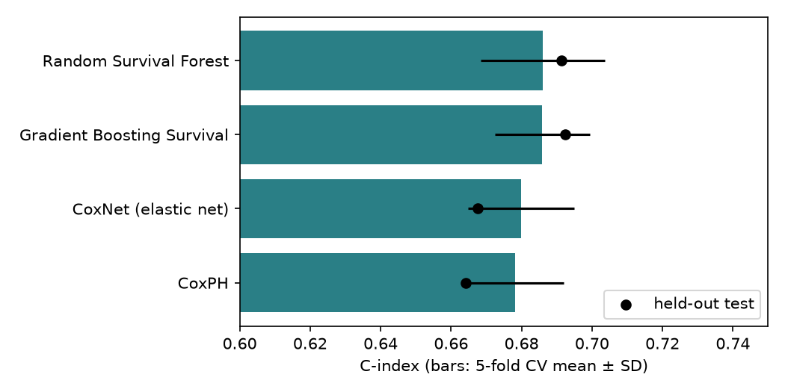
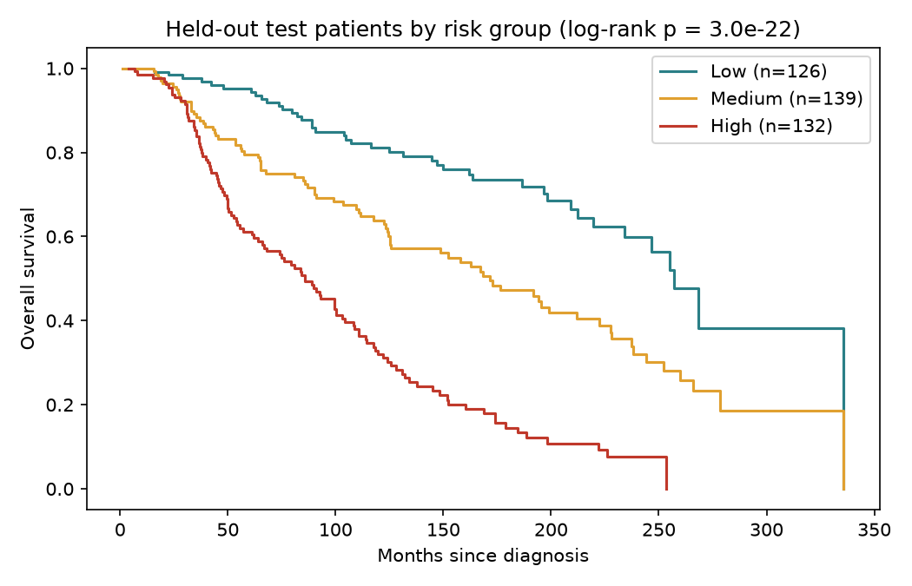
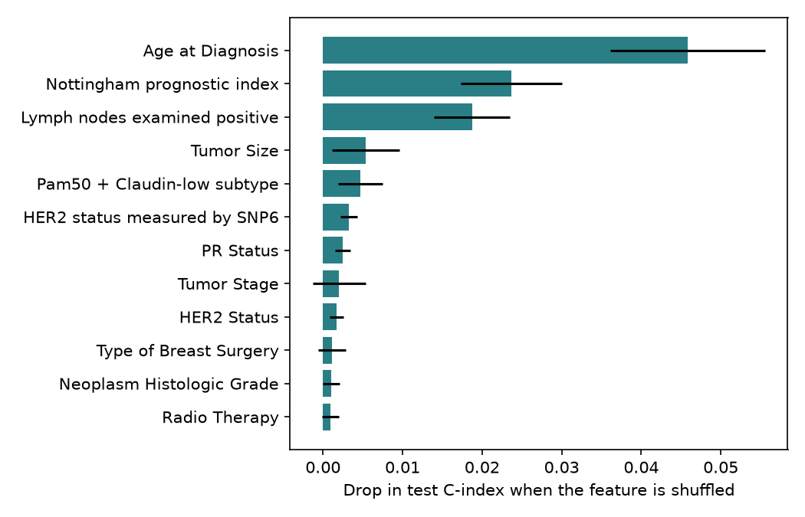
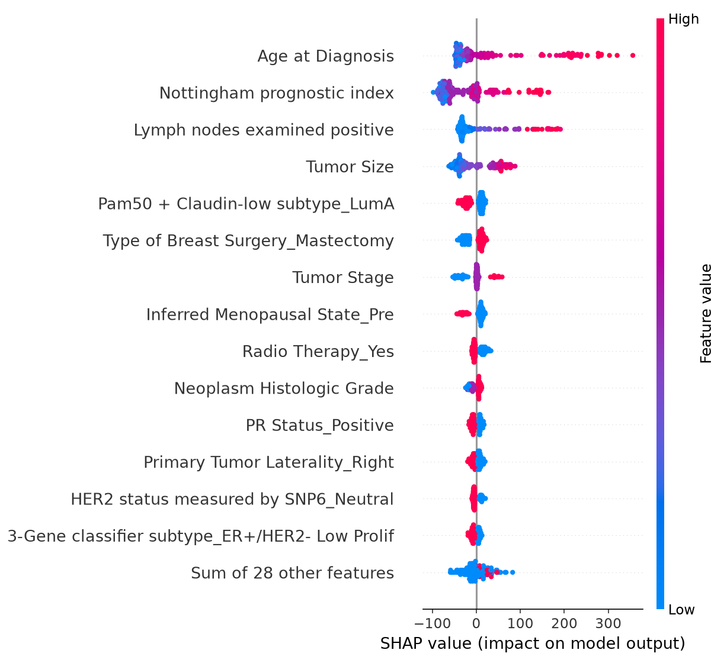

# OncoVision: METABRIC Risk Stratifier

Survival models that sort breast cancer patients into low, medium and high risk of death, built on the METABRIC cohort, with a Streamlit app.

**Live app:** https://metabric-risk-stratifier.streamlit.app/

**Research prototype. Not a medical device and not for treatment decisions.**

## Results at a glance

- **Data:** 1,981 patients (1,144 deaths), 21 clinical features. 528 patients in the source file have no recorded survival outcome and were removed, not imputed.
- **Best model:** Random Survival Forest, cross-validated C-index **0.686 ± 0.018**, held-out test C-index **0.691**. Gradient Boosting was effectively tied.
- **Risk groups** on 397 held-out test patients: deaths during follow-up range from **32.5% (low) to 82.6% (high)**, and 10-year survival from 81% to 32% (log-rank p = 3 × 10⁻²²).
- **Top predictors** (permutation importance and SHAP agree): age at diagnosis, Nottingham Prognostic Index, positive lymph nodes, tumour size.

## Benchmark

All models were scored with 5-fold cross-validation on the 1,584 training patients. The winner was picked on that score alone. The 397 test patients were used once, at the end.

| Model | CV C-index (mean ± SD) | Test C-index | Test AUC 5 y | Test AUC 10 y |
|---|---|---|---|---|
| Random Survival Forest | **0.686 ± 0.018** | 0.691 | 0.741 | 0.742 |
| Gradient Boosting Survival | 0.686 ± 0.014 | 0.692 | 0.740 | 0.749 |
| CoxNet (elastic net) | 0.680 ± 0.015 | 0.668 | 0.690 | 0.711 |
| CoxPH | 0.678 ± 0.014 | 0.664 | 0.688 | 0.707 |



## Risk groups

Cut-offs are the thirds of the training patients' out-of-bag scores (each patient scored only by trees that never saw them). They were then applied unchanged to the test patients.

| Risk group | Test patients | Died during follow-up | 5-year survival | 10-year survival | Median survival |
|---|---|---|---|---|---|
| Low | 126 | 32.5% | 95% | 81% | 257 months |
| Medium | 139 | 56.8% | 80% | 64% | 172 months |
| High | 132 | 82.6% | 61% | 32% | 86 months |



## What drives the predictions

| Permutation importance (test set) | SHAP (200 test patients) |
|---|---|
|  |  |

Older age, higher NPI, more positive nodes and larger tumours all push risk up, which matches clinical knowledge. Mastectomy pushes risk up and radiotherapy pushes it down. That reflects **who received** those treatments (sicker patients get more aggressive surgery), not what the treatments do, so the model must not be read as treatment advice.

## Methods and the reasons behind them

| Decision | Why |
|---|---|
| Drop the 528 patients with no survival outcome | Imputing the outcome would train and score the model on invented answers. |
| Overall survival (death from any cause) as the endpoint | It is the outcome the data records for every patient. 497 of the 1,144 deaths were from other causes, so disease-specific survival would be a sensible next study. |
| Drop 11 columns (see `EXCLUDED` in `oncovision.py`) | Relapse status and vital status restate the outcome (leakage); others are identifiers, duplicates, constant, or research-only labels a clinic would not have. |
| Fill missing values **inside** the model pipeline (median / most common, plus missing flags for numbers) | The fill values are learned from training patients only, so nothing leaks from the test set. 1,258 feature values were missing. |
| One-hot encode categories | Label-encoding categories such as cancer subtype as 0, 1, 2… imposes a false order on Cox models. |
| Stratified 80/20 split by event, seed 42 | Keeps the death rate the same in both sets. |
| Fixed hyperparameters, except CoxNet's penalty chosen by 5-fold CV on training data | Avoids tuning to the test set. |
| Harrell's and Uno's C-index plus time-dependent AUC | C-index measures ranking; AUC at 5 and 10 years shows performance at clinically meaningful times. |

## Limitations

- One cohort, no external validation. Treatments and survival have changed since METABRIC patients were diagnosed (1977–2005).
- C-index around 0.69 is moderate. The model ranks patients usefully but cannot predict an individual's outcome.
- Risk groups describe groups, not individuals.

## Run it yourself

```bash
pip install -r requirements-analysis.txt
python run_analysis.py           # cleans the data, runs the benchmark, writes results/
streamlit run streamlit_app.py   # the app trains its model on first start (about a minute)
```

| File | Contents |
|---|---|
| `oncovision.py` | Cleaning, feature list, the four model pipelines |
| `run_analysis.py` | Benchmark, risk groups, permutation importance, SHAP |
| `streamlit_app.py` | The app |
| `data/metabric_clean.csv` | Cleaned data (missing feature values left blank on purpose) |
| `results/` | Every table and figure in this README |

## References

1. Curtis C, et al. The genomic and transcriptomic architecture of 2,000 breast tumours. *Nature* 2012;486:346–352.
2. Ishwaran H, et al. Random survival forests. *Annals of Applied Statistics* 2008;2(3):841–860.
3. Pölsterl S. scikit-survival: a library for time-to-event analysis built on top of scikit-learn. *JMLR* 2020;21(212):1–6.

## License

Apache 2.0. See [LICENSE](LICENSE).
